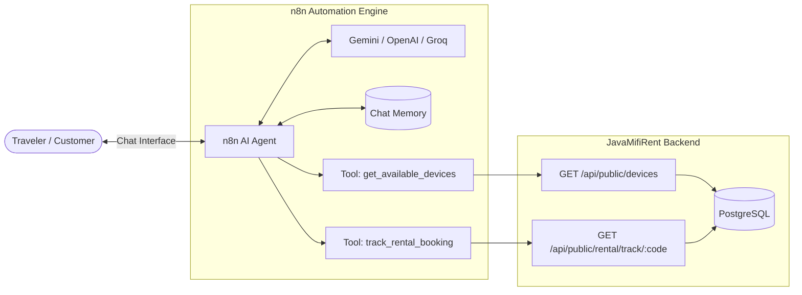

# JavaMifiRent - n8n AI Agent Integration & Quickstart Guide

This guide is a complete, beginner-friendly walkthrough for setting up and running **n8n** with our pre-built **JavaMifi AI Concierge & Support Agent**.

---

## 1. What This Automation Does

The n8n workflow implements an **autonomous AI Customer Support & Logistics Agent**:
- **Answers customer travel inquiries**: Recommends pocket Wi-Fi models (4G vs 5G) based on destination, duration, and budget.
- **Queries live hardware catalog**: Uses an internal API tool to fetch real-time available stock from JavaMifi's database (`GET /api/public/devices`).
- **Tracks live customer bookings**: Inspects order status, departure/return dates, pickup counter, or courier tracking number when given a Rental Code (`GET /api/public/rental/track/:code`).
- **Guides airport pickup & returns**: Provides 24/7 counter locations (CGK T3/T2, DPS, SUB), 24/7 airport arrival drop box instructions, and the non-airport courier return address.



---

## 2. How to Start n8n (Choose 1 Method)

### Method A: Instant Run via NPX (Recommended - No Install Needed)
Open a new PowerShell terminal and run:
```powershell
npx n8n
```
*n8n will start immediately and output: `Editor is available at http://localhost:5678`.*

### Method B: Run via Docker
```powershell
docker run -it --rm --name n8n -p 5678:5678 -v n8n_data:/home/node/.n8n docker.n8n.io/n8nio/n8n
```

Once running, open your browser at:  
👉 **[http://localhost:5678](http://localhost:5678)**

---

## 3. How to Import the Pre-Built Workflow

1. In n8n, create a free local account on first launch (name & password of your choice).
2. On the top right of the canvas, click the **`...` (Options menu)** $\to$ **Import from file**.
3. Select the file located in this repository:
   ```
   n8n/javamifi-ai-agent-workflow.json
   ```
4. The complete workflow with all nodes (**Chat Trigger**, **AI Agent**, **LLM Model**, **Memory**, and **2 API Tools**) will appear on your canvas.

---

## 4. Connecting Your AI Model API Key

The workflow defaults to **Google Gemini** (free API key available at [Google AI Studio](https://aistudio.google.com/)):

1. Double-click the **Google Gemini Chat Model** node.
2. Under **Credential to connect with**, select **Create New Credential**.
3. Paste your Gemini API key (or switch to **OpenAI / Groq** if you prefer).
4. Save the credential.

> **Tip for Docker users**: If running n8n inside Docker, change `http://localhost:5000` inside the two HTTP Request Tool nodes to `http://host.docker.internal:5000` so n8n can reach your local Express server. If running n8n via `npx n8n`, `http://localhost:5000` works directly out of the box!

---

## 5. Live Demonstration & Sample Prompts

Click **Chat** at the bottom of the n8n canvas (or open the Webhook Chat URL) to test live interactions:

### Test Prompt 1: Hardware Catalog & Recommendation
> **Customer**: *"Hi! I'm traveling to Tokyo for 5 days with 3 friends. I need fast internet for navigation and streaming. What devices do you recommend and how much does it cost?"*

- **AI Agent Action**: Autonomously calls `Tool: get_available_devices` (`GET /api/public/devices`).
- **AI Response**: Recommends the **Netgear Nighthawk M5 (5G, 1 Gbps)** or **GlocalMe DuoTurbo (4G)**, calculates `5 days × dailyRate`, and provides exact pricing in IDR.

---

### Test Prompt 2: Live Booking Tracking & Fulfillment
> **Customer**: *"Can you check the status of my rental booking RENT-20261021-0832BC?"*

- **AI Agent Action**: Autonomously extracts code `RENT-20261021-0832BC` and calls `Tool: track_rental_booking` (`GET /api/public/rental/track/RENT-20261021-0832BC`).
- **AI Response**: Confirms booking status (`CONFIRMED` or `ACTIVE`), destination (`Tokyo`), dates, and exact pickup counter (`Jakarta Soekarno-Hatta CGK T3 Departure Gate 1, open 24/7`).

---

### Test Prompt 3: Return Logistics Inquiry
> **Customer**: *"What should I do if my return flight lands at 2 AM, or if I forget to return the device at the airport?"*

- **AI Response**: Clarifies that the airport drop box at arrival is open **24/7** without queuing. If already home, provides the JavaMifi Central Return Hub address:
  > **JavaMifi Return Hub**  
  > Jl. Tomang Raya No. 12, Palmerah, Jakarta Barat 11440  
  > Attn: Return Dept

---

## 6. Technical Evaluation Alignment

| Requirement | How This Fulfills It |
| :--- | :--- |
| **Automation Tools using n8n** | Full conversational AI agent implemented in n8n with LangChain tool calling. |
| **API Connection** | n8n dynamically invokes internal REST endpoints on the Express 5 backend (`/api/public/devices`, `/api/public/rental/track/:code`). |
| **Business / ERP Relevance** | Automates the customer communication layer, booking verification, and logistics handover in the pocket Wi-Fi ERP ecosystem. |
